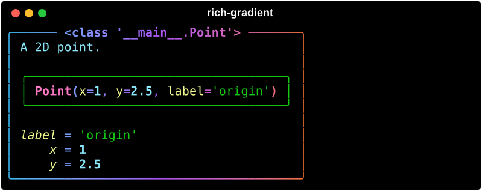

# Inspect

`rich_gradient.inspect` is a gradient version of [`rich.inspect`](https://rich.readthedocs.io/en/stable/reference/init.html#rich.inspect). It shows the same report on any Python object, but frames it in a gradient panel.



## Basic usage

```python
from dataclasses import dataclass

from rich_gradient import inspect


@dataclass
class Point:
    """A 2D point."""

    x: int = 1
    y: float = 2.5
    label: str = "origin"


inspect(Point(), colors=["#38bdf8", "#a855f7", "#f97316"])
```

`inspect()` takes the same options as `rich.inspect` (`methods`, `help`, `private`, `dunder`, `all`, `docs`, `value`, `sort`, `title`) plus the usual gradient options (`colors`, `bg_colors`, `rainbow`, `hues`):

```python
inspect(str, methods=True, rainbow=True)
```

## Staying readable

Only the frame, the title, and text Rich leaves uncolored (such as `=` signs and docstrings) take the gradient. Attribute names, values, and signatures keep the colors Rich gives them, so the report is as easy to scan as `rich.inspect`'s. To paint everything with the gradient instead, pass `keep_value_colors=False`.

## The `Inspect` renderable

`inspect()` prints straight away. To place the report inside other renderables, or print it later, build an `Inspect` instead. It is a gradient [`Panel`](panel.md), so it also takes panel options such as `box`, `border_style`, `title_style`, `expand`, and `justify`:

```python
from rich.box import HEAVY
from rich.console import Console
from rich_gradient import Inspect

Console().print(Inspect([1, 2, 3], colors=["#22c55e", "#a3e635"], box=HEAVY))
```

For the full signature see the [Inspect reference](inspect_ref.md).
