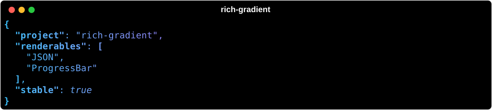

# JSON

`rich_gradient.JSON` wraps [`rich.json.JSON`](https://rich.readthedocs.io/en/stable/json.html) so formatted JSON is printed with a gradient across the output.



## Basic usage

```python
from rich.console import Console
from rich_gradient import JSON

console = Console()
console.print(JSON('{"project": "rich-gradient", "stable": true}', colors=["#38bdf8", "#a855f7", "#f97316"]))
```

Build one straight from a Python object with `JSON.from_data`:

```python
from rich_gradient import JSON

JSON.from_data({"items": [1, 2, 3]}, indent=4, sort_keys=True, rainbow=True)
```

## JSON options

The arguments Rich's `JSON` takes are forwarded: `indent`, `highlight`, `skip_keys`, `ensure_ascii`, `check_circular`, `allow_nan`, `default`, and `sort_keys`. The underlying Rich object is available as `json.json`.

`JSON.from_data` serializes with `json.dumps` and forwards `highlight` like the string constructor, so both honor it.

## Shared gradient options

Like every `Gradient`-based wrapper, `JSON` accepts `colors`, `bg_colors`, `rainbow`, `hues`, `repeat_scale`, `justify`, `vertical_justify`, `expand`, `highlight_words`, `highlight_regex`, and `console`. See [`Gradient`](gradient.md).

For the full signature see the [JSON reference](json_ref.md).
