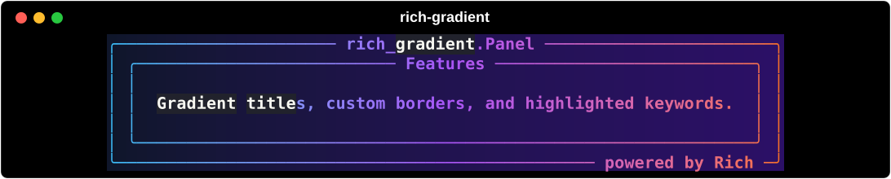
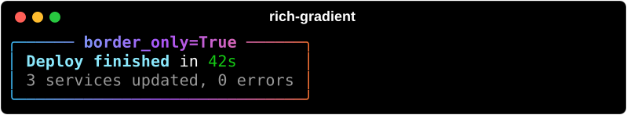

# Panel

`rich_gradient.Panel` wraps a `rich.panel.Panel`, applies gradient foreground and background colors, and automatically highlights the title and subtitle so they blend with the gradient. Because it inherits from [`Gradient`](gradient.md), every alignment and highlighting option is available.



```python
from rich.console import Console
from rich.panel import Panel as RichPanel
from rich_gradient import Panel

inner = RichPanel.fit(
    "[b]Gradient titles, custom borders, highlighted keywords.[/b]",
    title="[b]Features[/b]",
    padding=(1, 2),
)

console = Console()
console.print(
    Panel(
        inner,
        colors=["#38bdf8", "#a855f7", "#f97316"],
        bg_colors=["#0f172a", "#2c1067"],
        title="rich_gradient.Panel",
        subtitle="powered by Rich",
        border_style="bold",
        highlight_words=[(["Gradient", "keywords"], "bold white on black", False)],
    )
)
```

`style` and `border_style` accept any Rich style, but the gradient supplies the
colors: a foreground color in them is replaced by the gradient, and a background
color is kept only when no `bg_colors` are set. Use them for attributes such as
`bold`, `dim italic`, or `b u`. `title_style`, `subtitle_style`, and highlight
styles are drawn on top of the gradient, so colors there do show.

## Border-only gradients

Pass `border_only=True` to paint only the border with the gradient. The content is drawn exactly as a plain `rich.panel.Panel` would draw it, keeping its own colors, styles, and background. The title and subtitle take the gradient along with the border, because Rich draws them in the border style.



```python
from rich.console import Console
from rich_gradient import Panel

Console().print(
    Panel(
        "[bold cyan]Deploy finished[/] in [green]42s[/]\n[dim]3 services updated, 0 errors[/]",
        colors=["#38bdf8", "#a855f7", "#f97316"],
        title="border_only=True",
        border_only=True,
        expand=False,
    )
)
```

`AnimatedPanel` accepts `border_only` too, so the border animates while the content stays still. You can also switch it after construction with `panel.border_only = True`.

## Title and subtitle highlighting

When a title or subtitle is provided, the panel generates regex patterns that match the corresponding row in the rendered border and applies the supplied styles (`title_style` / `subtitle_style`). You can still pass your own `highlight_regex` or `highlight_words`; they’ll be merged with the title highlights.

Regex highlights support the same configuration shapes as [`Gradient`](gradient.md):

```python
import re

Panel(
    "Panel body",
    title="Status",
    highlight_regex=[
        (r"\bOK\b", "bold green"),
        (r"\berror\b", "bold #f00", re.IGNORECASE),
    ],
)
```

The third tuple item is optional. When omitted, regex flags default to `0`.

## Other options

- `padding`, `box`, `safe_box`, `width`, `height`: forwarded to the underlying Rich panel.
- `colors`, `bg_colors`, `rainbow`, `hues`: the same controls exposed by [`Gradient`](gradient.md).
- `justify`, `vertical_justify`: control how the inner panel is positioned within the gradient.
- `expand`: whether the panel fills the available width.

For animation support, see [`AnimatedPanel`](animation.md).
